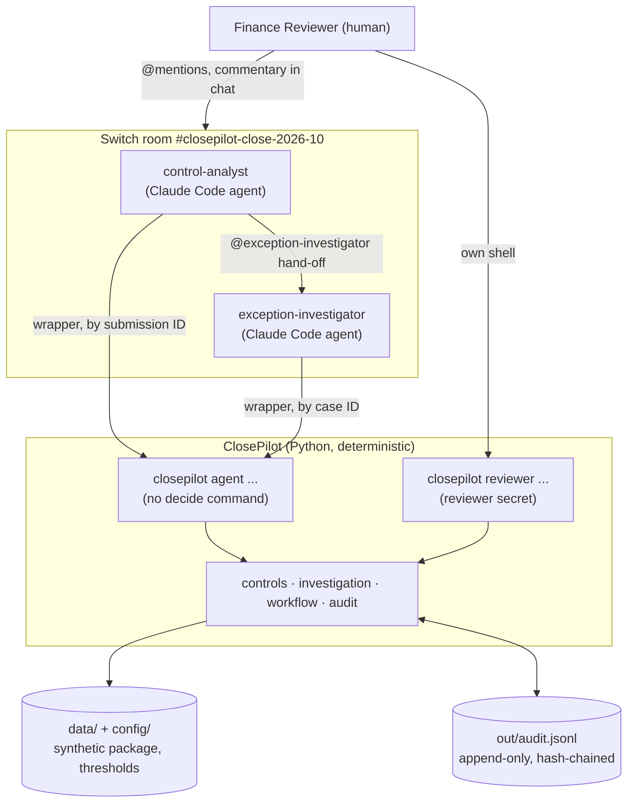
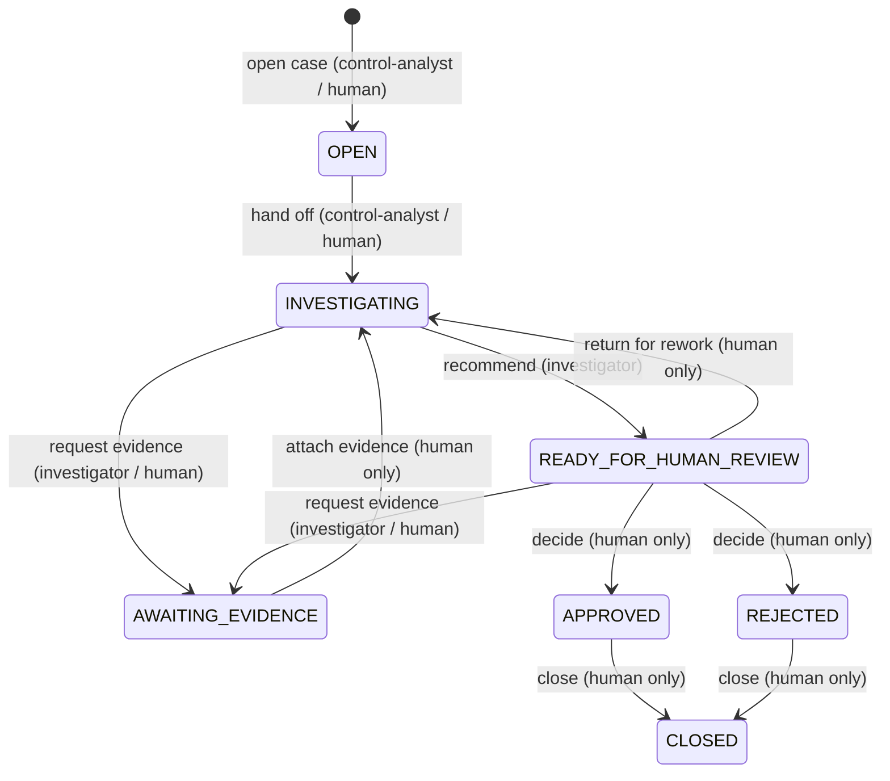

# Architecture

ClosePilot is a finance-control room: a human Finance Reviewer and two Claude Code agents collaborate in a Switch room around the same cases, while a deterministic Python core does every calculation and enforces every state change. This page covers the system context, components, the split between deterministic and generative work, the case-state model, data and audit flow, failure handling, Switch's role and the local deployment assumptions. Security boundaries and threats are in [threat-model.md](threat-model.md).

Diagrams are in Mermaid, which GitHub renders. Each has a plain-text version, so the page reads without it.

## System context



Text version:

```
Finance Reviewer ──@mentions──▶ Switch room ──▶ control-analyst ──@mention──▶ exception-investigator
       │                                              │                              │
       │ own shell (reviewer secret)                  └── closepilot agent ──────────┘ (wrapper, IDs only)
       ▼                                                          │
 closepilot reviewer ─────────────────────────────▶ ClosePilot domain: controls · investigation · workflow · audit
                                                                  │
                                         data/ + config/ (read)   │   out/audit.jsonl (append, replay)
```

## Components

| Component | Module(s) | Responsibility |
|---|---|---|
| Domain models | [`models.py`](../src/closepilot/models.py) | Records, findings, statuses, case states, actors, audit events |
| Configuration | [`config.py`](../src/closepilot/config.py), [`config/controls.yaml`](../config/controls.yaml) | Thresholds, allowed currencies and periods, evidence-required controls; validated on load |
| Submission registry | [`submissions.py`](../src/closepilot/submissions.py), [`config/submissions.yaml`](../config/submissions.yaml) | Maps a submission ID to a package inside the repository; agents never pass paths |
| Ingestion | [`ingestion.py`](../src/closepilot/ingestion.py) | Safe CSV loading, strict decimal parsing, malformed-row detection, size limits |
| Control engine | [`validation.py`](../src/closepilot/validation.py) | Controls C01–C07, severity precedence, per-currency control totals |
| Investigation | [`investigation.py`](../src/closepilot/investigation.py) | Rule-based facts, classification and next step for one case |
| Workflow | [`workflow.py`](../src/closepilot/workflow.py) | Case state machine, role permissions, evidence condition, replay validation |
| Audit log | [`audit.py`](../src/closepilot/audit.py) | Append-only JSON Lines, hash chain, lock, fsync and rollback |
| Reviewer check | [`reviewer.py`](../src/closepilot/reviewer.py) | Reviewer secret (scrypt hash), one-time enrolment, HMAC seals on human events |
| Reports | [`report.py`](../src/closepilot/report.py) | Decision record and package summary, built from audit events |
| Agent CLI | [`agent_cli.py`](../src/closepilot/agent_cli.py), [`switch/bin/closepilot-agent`](../switch/bin/closepilot-agent) | JSON commands for the two agents; identity from the working directory |
| Reviewer CLI | [`reviewer_cli.py`](../src/closepilot/reviewer_cli.py) | The human's commands, behind the reviewer check |
| Developer CLI | [`cli.py`](../src/closepilot/cli.py) | `closepilot validate`; fallback when Switch is unavailable |
| Switch assets | [`switch/`](../switch) | Room template, per-agent briefs and permission files |

The domain layer (models to reports) has no Switch, Claude or network code. It is fully testable on its own, and the CLIs are thin adapters over it.

## Deterministic versus generative responsibilities

| Done by Python (deterministic, tested) | Done by the agents (generative) |
|---|---|
| Parsing, every calculation, every threshold comparison | Deciding which command to run next, from their brief |
| Control results and severity | Explaining results in plain language in the room |
| Case states, permissions, the evidence condition | Writing hand-off notes, evidence requests, recommendation rationales |
| Investigation facts, classification, suggested next step | Choosing the wording of a recommendation (within APPROVE / REJECT) |
| Audit events, hash chain, seals, decision records | — |

**Never by an agent:** approving, rejecting, closing, attaching evidence, adding commentary, changing thresholds or data. Agents have no command for these, and the workflow refuses them from any agent actor.

## Case-state model



Text version:

```
(new)                  --open case-------------->  OPEN                     control-analyst, human
OPEN                   --hand off--------------->  INVESTIGATING            control-analyst, human
INVESTIGATING          --request evidence------->  AWAITING_EVIDENCE        investigator, human
READY_FOR_HUMAN_REVIEW --request evidence------->  AWAITING_EVIDENCE        investigator, human
AWAITING_EVIDENCE      --attach evidence-------->  INVESTIGATING            human only
INVESTIGATING          --recommend-------------->  READY_FOR_HUMAN_REVIEW   investigator
READY_FOR_HUMAN_REVIEW --return for rework------>  INVESTIGATING            human only
READY_FOR_HUMAN_REVIEW --decide----------------->  APPROVED or REJECTED     human only
APPROVED / REJECTED    --close------------------>  CLOSED                   human only
```

- Agents can only produce `OPEN`, `INVESTIGATING`, `AWAITING_EVIDENCE` and `READY_FOR_HUMAN_REVIEW`. An invariant in `workflow.py` enforces this independently of the rule table.
- `APPROVED` and `REJECTED` lead only to `CLOSED`, so a decision is never overridden.
- **Evidence condition:** for controls in `evidence_required_controls` (C01), or once evidence has been requested, approval can be neither recommended nor decided until the human has attached an evidence reference.
- Adding commentary (human only) and refused attempts (`ACCESS_DENIED`) leave the state unchanged.

## Data flow

1. A human addresses the Control Analyst in the room: `@control-analyst check FC-2026-10`.
2. The agent runs `validate FC-2026-10` through its wrapper. ClosePilot resolves the ID in `config/submissions.yaml`, loads and parses the CSV, runs C01–C07 and prints JSON. The agent posts the summary.
3. `open-cases` creates one case per `REVIEW_REQUIRED` or `ERROR` record. `handoff` passes cases to the investigator, and the agent wakes it with an `@exception-investigator` mention.
4. The investigator runs `investigate <CASE_ID>`. ClosePilot recomputes the package and returns facts and a next step. The agent requests evidence or commentary, or recommends.
5. The human adds commentary and evidence references, and decides, from their own shell with `closepilot reviewer …`. `export` and `summary` produce the decision record and package view.

Room messages, CSV cells and command output are treated as data at every step (see [threat-model.md](threat-model.md), T2).

## Audit flow

```
action ─▶ workflow: rebuild case by replaying out/audit.jsonl ─▶ validate the new event against the same rules
       ─▶ (human event) seal with HMAC from the reviewer secret
       ─▶ take lock ─▶ append canonical JSON line with prev_event_hash ─▶ fsync ─▶ release lock
       ─▶ return the new case (only if the write succeeded)
```

- The log is the single source of truth. No separate database or state file exists.
- Every read verifies the format and hash chain and re-checks every event against the workflow rules, so a forged agent approval makes reading fail closed.
- Human events carry a seal. `ENROL_REVIEWER` records the reviewer once, and reviewer commands verify both before acting.
- A failed write is rolled back, and the caller is told it failed.
- A decision record (`out/decisions/<case>.md` and `.json`) is derived from events and includes the hash of the log's newest event as an outside anchor.

## Failure handling

| Failure | Behaviour |
|---|---|
| Malformed configuration | Stops with a `ConfigError` naming the setting; exit code 2 |
| Missing or repeated column | Package rejected as a whole; exit code 2 |
| Malformed or oversized amount, shifted row | That record is `ERROR` (C07); the rest of the package is processed |
| Unknown or path-like submission ID | Refused; exit code 2 |
| Invalid transition, missing evidence, bad input | Refused with a clear message; nothing is written; exit code 3 |
| Agent or unverified actor attempts a human action | Refused and recorded as `ACCESS_DENIED`; exit code 3 or 5 |
| Wrong or missing reviewer secret | Refused (exit code 5) and recorded; case unchanged |
| Broken hash chain, rule-breaking event, bad seal, replaced reviewer file | Every command stops; exit code 4; nothing is written |
| Audit write fails | Rolled back; error raised; the action is not reported as recorded |
| Log locked (concurrent or interrupted command) | Waits up to 5 s, then fails without writing; a human removes a stale lock |
| Agent unavailable or session stopped | Case state is unchanged; the next addressed message starts a new session |
| Switch unavailable | Everything except the room works: `closepilot validate`, `closepilot agent …` and `closepilot reviewer …` run locally, and the test suite needs no Switch |

## Switch's role

Switch provides what a script on its own cannot:

- **Shared context.** One room where the human and both agents see the same messages, results and hand-offs. Room instructions brief every agent that joins.
- **Agent-to-agent hand-off.** The Control Analyst wakes the investigator with a real `@exception-investigator` mention. This was verified live, because agent addressing is `owner-agents`.
- **Session management.** Switch Console starts each agent's Claude Code session on demand, in its own working directory, with Switch tools served locally.
- **Addressing and permissions.** Who may instruct each agent; permission requests are posted in the room and recorded.

What Switch does **not** do is decide what an agent may do to a case: its docs leave that to the application. ClosePilot therefore enforces the human-only gate itself, in the workflow, the reviewer check and the seals.

## Local deployment assumptions

- One Windows 11 machine running everything as one OS user: Python 3.13 (conda env `closepilot`), Git, Claude Code, Switch Console 0.40.1 with its local Switch server, and Mattermost in Docker.
- The agents run as Switch-managed Claude Code sessions in `switch/agents/<name>/`. Their shell is Git Bash, which is why `switch/local/python` (git-ignored) points the wrapper at the right interpreter.
- No network services beyond the local Switch server and Mattermost; no cloud, database or web framework.
- Synthetic data only, about the fictional Northstar Logistics Group.
